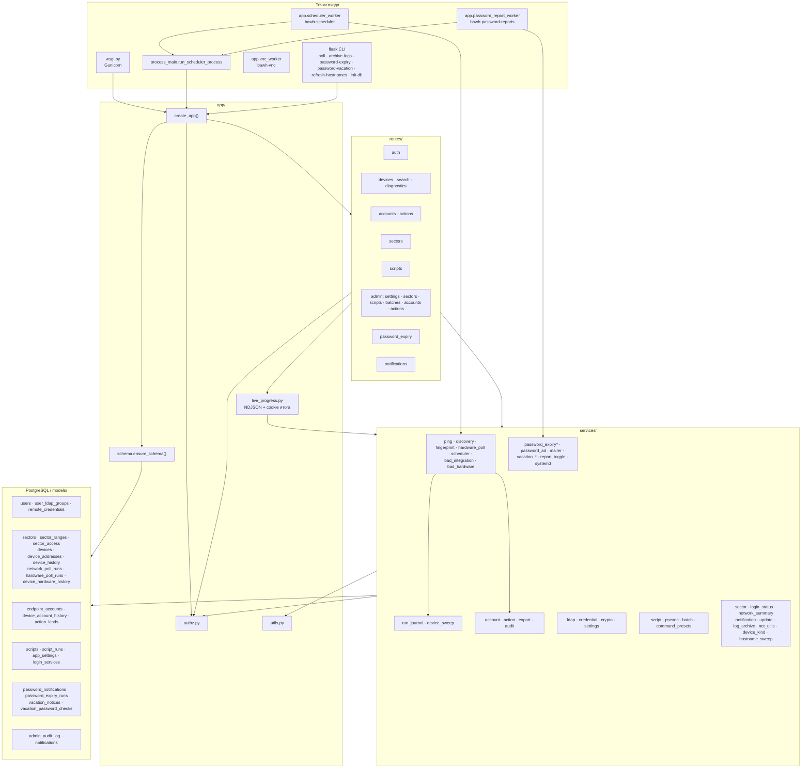
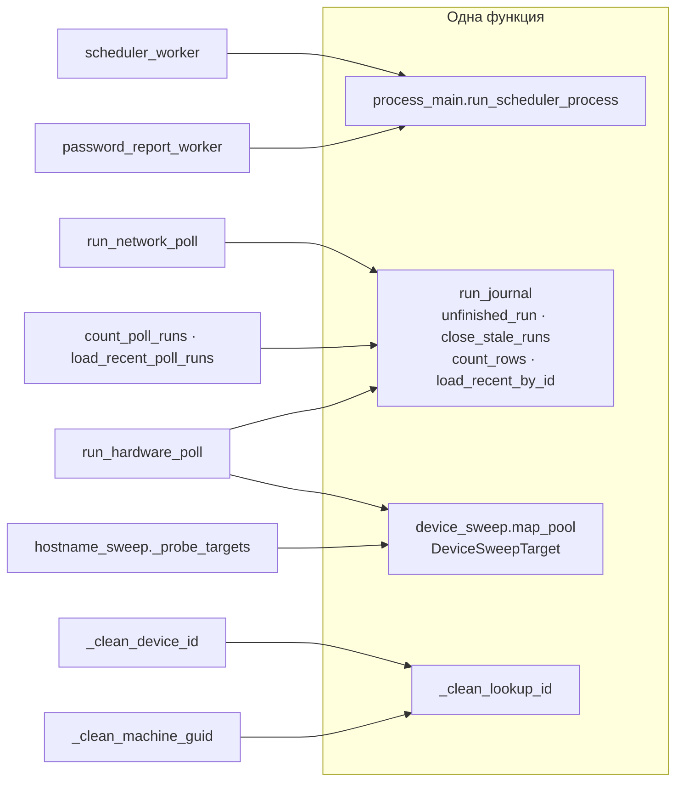
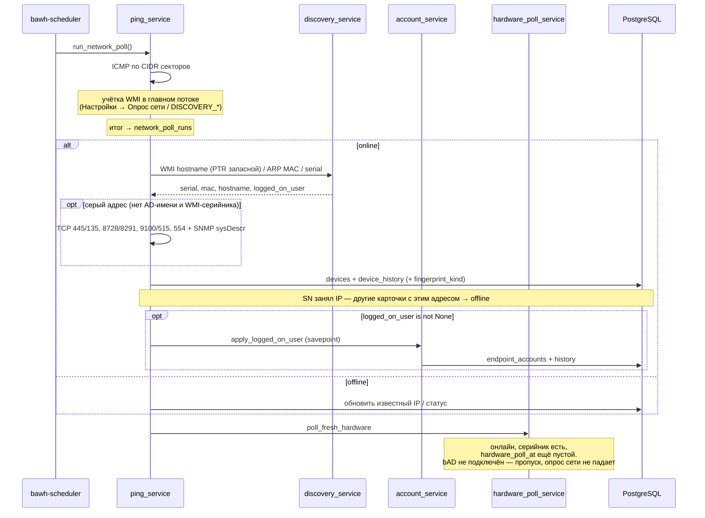
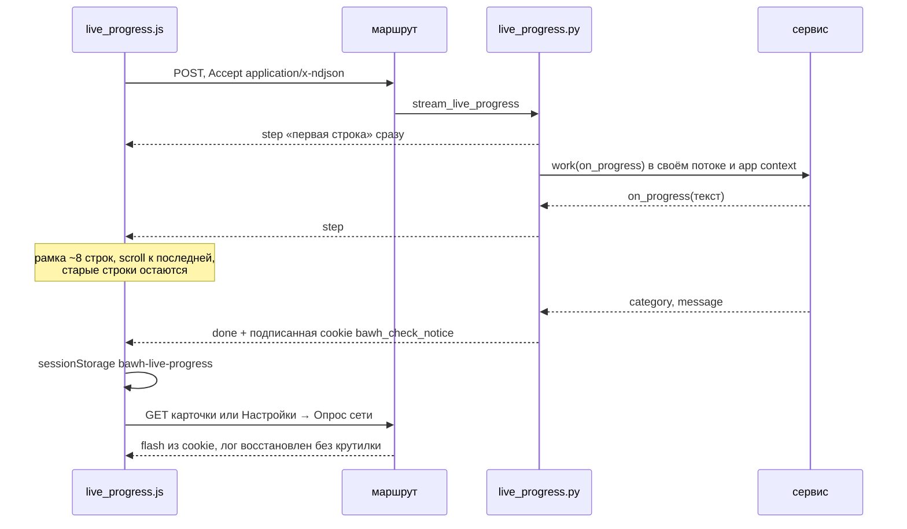

# Архитектура bAWH (актуально для v2.7)

> **Для ИИ и разработчиков:** это каноническая карта слоёв и договорённостей.
> Таблица узлов и связей — [`graphify-out/GRAPH_REPORT.md`](../graphify-out/GRAPH_REPORT.md),
> сам граф — `graphify-out/graph.json`. Оба файла в git, чтобы другой агент
> читал их без повторной сборки. Кэш, `manifest.json` и `.graphify_analysis.json`
> локальные. После изменений кода: `graphify update .`, затем
> `graphify cluster-only . --no-label`.
> Перед поиском по репозиторию прочитай этот файл целиком — здесь слои, точки входа,
> модели, сервисы, маршруты, authz, фоновые задачи и соглашения.
> Установка и ops — в [README.md](../README.md).
> Текст скриптов для формы Настройки → Скрипты — в [SCRIPTS.md](SCRIPTS.md).

**Продукт:** внутренний веб-помощник администратора сети (карта устройств,
секторы/CIDR, ICMP+WMI+TCP/SNMP опрос, диагностика, скрипты на Windows через PsExec,
веб-VNC (экспериментально), LDAP-вход, отчёт по сроку паролей AD и in-app уведомления).
Рассчитан на корпоративную LAN, не для публикации в интернет.

**Версия:** файл [`VERSION`](../VERSION) → `2.7` (читает `app/version.py`).

**Стек:** Flask 3 SSR (Jinja2) · SQLAlchemy 2 / Flask-SQLAlchemy · PostgreSQL
(prod; SQLite допустим локально) · Flask-Login · Flask-WTF CSRF · APScheduler
(отдельный процесс) · ldap3 · cryptography Fernet · pypsexec · impacket (WMI) ·
Gunicorn + Nginx · Bootstrap 5 (vendorized) · noVNC + `websockets` (процесс `bawh-vnc`).

**Нет в репозитории:** Alembic / Flask-Migrate, Redis, Celery, WebSocket *в Flask*,
Telegram, S3, SPA-фреймворка, Pydantic. Каталог `tests/` тоже не в git
(локальный `unittest`, без pytest в requirements). Веб-VNC — отдельный процесс, не Gunicorn.

---

## 1. Слои и правило зависимости

```
HTTP / CLI / scheduler
        ↓
  routes/  (или scheduler_service / flask CLI)
        ↓
  services/   ← бизнес-логика; без Flask request/response
        ↓
  models/ + PostgreSQL
```

| Слой | Каталог / файл | Правило |
| --- | --- | --- |
| Маршруты | `app/routes/` | Только HTTP: форма → сервис → шаблон/JSON. **Не** пингуют и не ходят в LDAP/PsExec напрямую. |
| Сервисы | `app/services/` | Вся логика: опрос, LDAP, WMI, PsExec, УЗ, экспорт. Вызываются из веба, планировщика и CLI. |
| Модели | `app/models/` | Таблицы SQLAlchemy. Без HTML и сетевых вызовов. |
| Схема БД | `app/schema.py` | `ensure_schema()`: `create_all` для недостающих таблиц + seed `action_kinds` + идемпотентные data-fix (флаг в `app_settings`). |
| Authz | `app/authz.py` | Вошедший видит всё. Отдельных ролей и ACL секторов нет. |
| Утилиты | `app/utils.py` | `utcnow` / `as_utc` / `ilike_pattern` / `clip` / пагинация. |

**Инвариант:** маршрут не делает side-effect сеть/LDAP; сервис не рендерит HTML.

---

## 2. Точки входа

| Точка | Файл / команда | Что делает |
| --- | --- | --- |
| Веб (prod) | `wsgi.py` → `create_app()` → Gunicorn `wsgi:app` | Только HTTP. Опрос здесь **запрещён**. |
| Веб (dev) | `python wsgi.py` (:8000) или `flask --app wsgi run` | То же. |
| Планировщик | `python -m app.scheduler_worker` | `run_scheduler_process(start_scheduler)`: опрос сети, железо известных компьютеров по интервалу, заявка bAD, архив логов. |
| Отчёты паролей | `python -m app.password_report_worker` | Тот же `run_scheduler_process`, старт `start_password_report_scheduler`: cron отчёта и cron проверки отпусков. |
| VNC-прокси | `python -m app.vnc_worker` | WebSocket→TCP, без Flask/БД; билет `SECRET_KEY`. Свой цикл, не APScheduler. |
| Flask CLI | `flask --app wsgi …` | `poll`, `archive-logs`, `password-expiry [--dry-run]`, `password-vacation [--dry-run]`, `refresh-hostnames [--dry-run]`, `init-db`. |
| Docker | `Dockerfile` | Опциональный web-only образ; scheduler/отчёты — отдельно. |

Фабрика: `app/__init__.py` → `create_app(config_name)`.

Порядок в `create_app`:

1. `load_dotenv()` → конфиг из `APP_CONFIG` / `CONFIGS` (`default` | `development` | `testing`)
2. `configure_logging`
3. `db` / `login_manager` / `csrf` (`app/extensions.py` — **без** migrate)
4. `import app.models` + `user_loader`
5. blueprints + error handlers 403/404/500
6. `register_commands` (CLI планировщика) + CLI `init-db`
7. `ensure_schema()` в app context
8. `GET /health` → `{"status": "ok"}` (без auth)
9. template filter `dt`, context `app_name`, shell context

Планировщик в `extensions` **не** создаётся — иначе каждый воркер Gunicorn запустил бы свой опрос.

---

## 3. Каталоги репозитория

```
bAWH/                          # на сервере = /opt/bawh
  VERSION                      # semver (2.7)
  wsgi.py                      # WSGI entry
  requirements.txt
  .env.example
  Dockerfile                   # опционально, только web
  README.md                    # установка и ops
  docs/ARCHITECTURE.md         # ← этот файл
  app/
    __init__.py                # create_app
    config.py
    extensions.py              # db, login_manager, csrf
    schema.py                  # ensure_schema (вместо Alembic)
    authz.py
    live_progress.py             # NDJSON шагов долгих кнопок + cookie итога
    utils.py
    logging_config.py
    version.py
    run_display.py             # подписи статусов запусков для UI
    scheduler_worker.py
    password_report_worker.py
    process_main.py            # общий цикл ожидания APScheduler
    models/
    services/
    routes/
    templates/
    static/                    # css/, js/, vendor/bootstrap/
  deploy/                      # Debian 12: systemd, nginx, install
  vnc-agents/                  # MSI TightVNC (файлы .msi не в git)
  tests/                       # локально, в gitignore
  logs/                        # runtime (в gitignore содержимое)
```

---

## 4. Диаграмма слоёв



Кнопка «Опросить сейчас» на карточке идёт из `routes/devices.py` в `hardware_poll_service`. Планировщик вызывает `poll_due_hardware`, опрос сети — `poll_fresh_hardware`. Живые шаги трёх кнопок (проверка, железо, ручной опрос сети) идут через `live_progress.py`, не через отдельный прогресс у каждой кнопки.

Настройки — один префикс `/admin`. Сектора, библиотека скриптов, пачки запусков, обнаруженные УЗ и лента действий живут там же, что Общие, HTTPS, почта и опрос сети. LDAP модуля паролей — `/admin/settings/ldap`, пороги отчёта — `/admin/settings/passwords`. Операционный отчёт остаётся `/password-expiry`. Старые `/scripts`, `/sectors`, `/accounts`, `/actions`, `/password-expiry/settings` и `/password-expiry/report-settings` отвечают **308** (`routes/legacy.py`), метод запроса сохраняется.

Карточка устройства не повторяет одни и те же блоки на вкладках. Обзор — паспорт и одна строка железа. Полный снимок и кнопка bAD — вкладка «Оборудование». Ping, Tracert и «Проверить сейчас» — вкладка «Опросы». Пачки, в которых была эта машина, — вкладка «Команды» и список `/admin/scripts/batches`.

### 4.1. Одинаковый смысл

Код писали разные агенты. Ниже то, что уже сведено в одну функцию, и то, что выглядит похоже, но сливать нельзя.



| Свели | Куда | Что было дважды |
| --- | --- | --- |
| Цикл «создай app, спи, пока не Ctrl+C, shutdown(wait=True)» | `app/process_main.py` | `scheduler_worker.main` и `password_report_worker.main`. Тексты в лог остались разными. |
| Незавершённый прогон и зависший прогон | `services/run_journal.py` | `_active_poll_run` / `_close_stale_poll_runs` и `_active_run` / `_close_stale_runs`. Текст ошибки у каждого журнала свой. |
| «посчитать строки» и «последние по id» | те же `count_rows` / `load_recent_by_id` | журналы опроса сети. Список железа в настройках удалён вместе с вкладкой, функции списка прогонов железа тоже. |
| Пул потоков по целям | `services/device_sweep.py` | одинаковый `ThreadPoolExecutor` в опросе железа и в `hostname_sweep`. |
| Обрезка идентификатора lookup | `discovery_service._clean_lookup_id` | `_clean_device_id` и `_clean_machine_guid` повторяли strip / длину / управляющие символы. |
| Перезапуск systemd | только `systemd_service.run_service_restart` | `update_service` держал однострочные копии `restart_command` и `run_service_restart`. Копии удалены. `restart_command` больше ниоткуда не вызывался — удалён. Подсказка оператору — `restart_units_hint`. |
| Статус unit | `systemd_service.get_unit_status` | неиспользуемый `report_toggle_service.unit_status`. `password_reports_status` оставлен: это имя службы паролей для страницы отчёта. |

| Похоже, но смысл разный — не сливать | Почему |
| --- | --- |
| `hostname_key` и `_normalize_hostname` | ключ сравнения — короткое имя в нижнем регистре без домена. Имя для карточки сохраняет регистр и домен. |
| `_clean_device_id` и `_clean_machine_guid` | оба зовут `_clean_lookup_id`, но device_id ещё отвергает `bad_ak_` / `bad_in_` / `bad_ps_` / `bearer`. Иначе ключ агента из JSON мог бы уйти в lookup. |
| `_load_targets` железа и имён | у железа лимит считается после фильтра Windows. У имён `LIMIT` в SQL стоит до отбрасывания пустого IP. Общий загрузчик поменял бы, кого опрашивают. |
| `_Probe` железа, имён и ICMP | разные поля: снимок bAD, OS-имя, или ping/fingerprint. |
| `format_change_lines` у `hostname_sweep` | строка CLI про смену имени. Бывший форматтер железа (CPU/ОЗУ) никто не вызывал после удаления CLI `hardware-poll` — удалён. |
| `run_service_restart` и `run_core_service_restart` | полный список unit'ов и запасной restart только `bawh-scheduler` + `bawh-web` для старого sudoers. |
| `PollInProgressError` и `HardwarePollInProgressError` | разные экраны и тексты. Общая проверка строки — в `run_journal`, исключения остаются своими. |
| `password_reports_status` | тонкая обёртка над `get_unit_status(PASSWORD_REPORTS_UNIT)`, чтобы маршрут не знал имя unit. |
| `vnc_worker` | не планировщик: asyncio, без Flask и без БД. |

---

## 5. Схема БД (без Alembic)

Файл: `app/schema.py`.

```python
def ensure_schema() -> None:
    # 1) если в metadata есть таблицы, которых нет в БД → db.create_all()
    # 2) колонки из моделей, которых нет в существующих таблицах → ALTER TABLE ADD COLUMN
    # 3) data-fix: номиналы ОЗУ/ПЗУ v1.5.1 (флаг app_settings data_fix.hw_gb_nominal_v151)
    # 4) скрипт TightVNC (удаление) в библиотеке (data_fix.seed_tightvnc_script_v176)
    # 5) если action_kinds пуст → seed_action_kinds() + commit
```

Вызывается при каждом старте `create_app` (web и scheduler).  
CLI `flask --app wsgi init-db` — то же (схема уже поднята фабрикой; команда печатает `database ready`).  
Установщик и self-update вызывают `flask init-db`.

**Таблицы:** `create_all` создаёт только **недостающие** таблицы. Новая сущность =
модель + экспорт в `models/__init__.py`; при деплое таблица появится на следующем старте.
Удаление модели таблицу в Postgres не дропает. После 1.12 в базе могут остаться
`sector_daily_report_runs` и старые строки `hardware_poll_runs` — кода, который
их читает как отчёт, больше нет.

**Колонки:** `ensure_schema` догоняет недостающие колонки через `ALTER TABLE … ADD COLUMN`
(с `DEFAULT` из `server_default` / скалярного `default`, иначе NOT NULL без default
добавляется как NULL). Это покрывает типичный случай «переустановили `/opt`, Postgres
не чистили» (например `users.is_viewer`). Не делает: rename/drop колонок, смену типа,
новые UNIQUE/FK/индексы на уже существующих колонках — для этого нужен ручной SQL
или пересоздание БД.

**Data-fix v1.5.1:** после опроса на v1.5.0 в `devices` / `device_hardware_history`
лежат «рваные» ГБ (15 ОЗУ, 238/244 диск). При старте 1.5.1 `normalize_stored_capacity_gb`
один раз приводит их к номиналу; маркер `data_fix.hw_gb_nominal_v151` в `app_settings`.
Повторный WMI-опрос для этого не нужен.

**Сид TightVNC:** при старте в библиотеку кладётся неопубликованное тело
«TightVNC (тихое удаление)» из `app/services/tightvnc_install_script.py`.
Старое «TightVNC (тихая установка)» заменяется. MSI админ кладёт в `vnc-agents/`;
при «Подключить» на карточке агент ставится или обновляется (пароль/порт/файрвол).
Маркер `data_fix.seed_tightvnc_script_v176`.

---

## 6. Модели (`app/models/`)

Импорт всех таблиц: `app/models/__init__.py`. Mixin: `TimestampMixin` в `base.py`.

| Модель | Таблица | Файл | Назначение |
| --- | --- | --- | --- |
| `User`, `UserLdapGroup` | `users`, `user_ldap_groups` | `user.py` | Люди после LDAP. Успешный вход ставит `is_admin=True` и сбрасывает старые флаги `is_viewer` / `is_operator` / `is_password_viewer`. Группы — снимок memberOf, на права не влияют. |
| `Sector`, `SectorRange`, `SectorAccess` | `sectors`, `sector_ranges`, `sector_access` | `sector.py` | Подсети (CIDR). `sector_access` в схеме остаётся и больше не фильтрует карту. |
| `Device`, `DeviceAddress`, `DeviceHistory` | `devices`, `device_addresses`, `device_history` | `device.py` | Машины + адреса интерфейсов + журнал опросов. Идентичность: **только** `serial_number` (WMI инвентаря сети). `hostname` — отображение, не ключ. `devices.ip` — основной (последний онлайн); `device_addresses` — все виденные IP/MAC (Wi‑Fi + Ethernet). Без SN — заглушка на текущем IP. Снимок железа (CPU/ОЗУ/диск/ОС, `bad_id`) пишет lookup bAD: кнопка, первое появление серийника и интервал известных машин. `device_id` в таблицу не кладётся. |
| `NetworkPollRun` | `network_poll_runs` | `poll_run.py` | Журнал полных прогонов ICMP-опроса. |
| `HardwarePollRun`, `DeviceHardwareHistory` | `hardware_poll_runs`, `device_hardware_history` | `hardware.py` | Замок одного прогона железа (кнопка, новые серийники, интервал) и история смены CPU/ОЗУ/дисков/ОС. Страницы журнала прогонов нет. |
| `EndpointAccount`, `DeviceAccountHistory` | `endpoint_accounts`, `device_account_history` | `account.py` | УЗ на конечных точках (**не** путать с `users`). |
| `ActionKind` | `action_kinds` | `action.py` | Справочник типов (`ACTION_KIND_SEED` / `seed_action_kinds`). |
| `Script`, `ScriptRun` | `scripts`, `script_runs` | `script.py` | Библиотека и журнал запусков. У скрипта: `run_as`, `is_published`. У run: `run_type`, `batch_id`, статус. |
| `AppSetting`, `RemoteCredential` | `app_settings`, `remote_credentials` | `setting.py` | KV-настройки; per-user Fernet-шифротекст PsExec/пароля входа. |
| `PasswordNotification`, `PasswordExpiryRun` | `password_notifications`, `password_expiry_runs` | `password_expiry.py` | Письма о сроке пароля + снимки прогонов. |
| `VacationNotice`, `VacationPasswordCheck` | `vacation_notices`, `vacation_password_checks` | `password_expiry.py` | Письма кадров об отпуске и проверка, истечёт ли пароль за отпуск. |
| `LoginService` | `login_services` | `login_service.py` | Сервисы для блока доступности на `/login`. |
| `AdminAuditLog` | `admin_audit_log` | `audit.py` | Журнал админ-действий. |
| `Notification` | `notifications` | `notification.py` | In-app колокольчик: `script_failed`. |

Не таблицы (enum/константы): `DeviceStatus`, `SessionType`, `RunType`, `RunStatus`,
`RunAs`, `NotificationKind`, `ActionKindCode`.

Seed коды действий: `poll`, `ping`, `tracert`, `command`, `script`, `account_sighting`.

### Кто пишет / кто читает

| Сущность | Таблица | Пишет | Читает |
| --- | --- | --- | --- |
| Оператор сайта | `users` | `ldap_service` | auth, authz |
| УЗ на ПК | `endpoint_accounts` | `account_service` | `/admin/accounts`, карточка устройства |
| Появление УЗ | `device_account_history` | `account_service` | `/admin/actions`, вкладка accounts |
| Типы действий | `action_kinds` | `ensure_schema` / seed | `/admin/actions` |
| Запуски | `script_runs` | `script_service` | `/admin/scripts/runs`, `/admin/actions` |
| Пачки | `script_runs.batch_id` | `batch_service.list_batch_summaries` | `/admin/scripts/batches` |
| Опросы | `device_history` | `ping_service` | вкладка polls |
| Прогоны опроса | `network_poll_runs` | `ping_service.run_network_poll` | `/admin/settings` |
| Прогоны железа | `hardware_poll_runs` | `hardware_poll_service.run_hardware_poll` | только замок «уже идёт»; UI журнал не читает |
| Снимки железа | `devices` + `device_hardware_history` | `hardware_poll_service` | карточка, вкладка «Оборудование» |
| Аудит админа | `admin_audit_log` | `audit_service` | `/admin/audit` |
| Уведомления | `notifications` | `notification_service` (script_failed) | `/api/notifications` |

---

## 7. Сервисы (`app/services/`)

### Сеть и опрос

| Модуль | Роль |
| --- | --- |
| `net_utils.py` | `parse_range`, `expand_ranges`, `normalize_mac`, `assert_host_or_ipv4`, `resolve_to_ipv4` |
| `ping_service.py` | ICMP; `run_network_poll` (mutex + журнал) → `poll_all_sectors`; `ping_host` / `trace_host` / `check_device` (доступность карточки через `confirm_device_address`, не голый ICMP); ThreadPoolExecutor. После ICMP+WMI серые адреса — `fingerprint_service` |
| `fingerprint_service.py` | короткий TCP (445/135, 8728/8291, 9100/515, 554) + SNMPv1 sysDescr `public`; без новых зависимостей |
| `device_kind.py` | тип карты: имена AD (`BN***` = ноутбук, `n…`/`w…`/…), WMI-серийник, fingerprint, PTR/OUI; флаги `kind_shows_accounts` / `mac` / `serial` / `hardware` / `commands` («Прочее» ≈ ноутбук) |
| `discovery_service.py` | reverse DNS, ARP MAC, WMI (impacket): serial / MAC / hostname / logged_on_user для опроса сети. Для bAD — `lookup_badagent`: служба `badagent` и, только если она есть, `device_id` из конфига агента (только это поле; ключ агента отбрасывается) либо MachineGuid. Имя карточки: WMI `DNSHostName`/`Name`, PTR только если WMI пустой. Учётка: Настройки → Опрос сети или `DISCOVERY_*` |
| `hardware_info.py` | чистый разбор снимка: ГБ (ОЗУ — ГиБ/планки, диски — этикетка 1000³ + номинал), семейство 10/11/Server, редакция Pro/Enterprise, 25H2/26H2 |
| `hardware_poll_service.py` | ping + служба badagent + lookup bAD. Снимок на `devices` только если серийник снимка bAD совпадает с карточкой (иначе remap на владельца SN или skip — VPN/DHCP). История при изменении. Mutex + `hardware_poll_runs` через `run_journal`. Пока связь не «подключено», проход не стартует. WMI CPU/ОЗУ/дисков/ОС нет. Кнопка карточки, конец опроса сети для карточек с серийником без попытки, и планировщик по интервалу `hardware_poll_interval_seconds` (по умолчанию сутки). `device_id` не пишется. Шаги одной машины — `on_progress` |
| `run_journal.py` | общий замок прогона: незавершённая строка, зависший прогон, count/limit по id |
| `device_sweep.py` | `DeviceSweepTarget` и `map_pool` для прохода по уже известным карточкам |
| `bad_integration.py` | адрес bAD, заявка, poll секрета, одноразовый `token`. Секреты — Fernet в `app_settings`. `BAD_ADMIN_TOKEN` не используется |
| `bad_hardware.py` | карточка lookup → CPU / ОЗУ / диски / ОС и `bad_id`. `device_id` на карточку не кладётся |
| `hostname_sweep_service.py` | разовый проход по уже известным `devices`: ping + WMI-имя → UPDATE hostname. Не сливает строки; чужой SN на том же IP — не пишет имя. CLI `refresh-hostnames`, кнопка в Настройки → Опрос сети |
| `scheduler_service.py` | APScheduler jobs + Flask CLI |
| `network_summary_service.py` | сводка карты + health планировщика |

### Идентичность и секреты

| Модуль | Роль |
| --- | --- |
| `ldap_service.py` | bind/search, допуск по `LDAP_ADMIN_GROUP`, `upsert_local_user` |
| `crypto_service.py` | Fernet `encrypt` / `decrypt` |
| `credential_service.py` | `get_remote_admin_credentials`, `save_remote_admin_credentials`, `remember_login_password` |
| `settings_service.py` | интервал опроса, WMI creds, update-sudo в `app_settings` |

### УЗ, действия, экспорт

| Модуль | Роль |
| --- | --- |
| `account_service.py` | NetBIOS-нормализация домена, upsert УЗ, sightings, ACL-списки |
| `action_service.py` | лента действий (script_runs + account history) с authz как у run_detail |
| `export_service.py` | CSV (accounts, actions, poll runs) |
| `audit_service.py` | запись/чтение `admin_audit_log` |

### Удалённый запуск и скрипты

| Модуль | Роль |
| --- | --- |
| `psexec_service.py` | pypsexec-сессии, cancel/close. PowerShell: файл в `ADMIN$\Temp` + `cmd.exe -File` (не `-EncodedCommand`, иначе `STATUS_PIPE_BROKEN`); stdout в канал сразу (`on_output` → живой журнал); CLIXML вырезается |
| `vnc_token.py` | itsdangerous-билет: IP/порт из инвентаря, TTL 90 с; прокси без БД |
| `vnc_settings.py` | порт агента, общий пароль Fernet, тумблер шлюза |
| `tls_pem.py` / `tls_settings.py` / `tls_service.py` | PEM из Настройки → HTTPS, файлы в `certs/`, `apply-nginx-tls.sh` |
| `script_service.py` | CRUD/тело скриптов; enqueue на ThreadPoolExecutor в веб-процессе |
| `batch_service.py` | bulk ping/script, статус одной пачки и список `list_batch_summaries` |
| `command_presets.py` | статические пресеты команд |

### Пароли AD

| Модуль | Роль |
| --- | --- |
| `password_expiry_service.py` | оркестрация прогона |
| `password_ad_client.py` | LDAP: пользователи и days-left |
| `password_mailer.py` | SMTP |
| `password_expiry_settings.py` | SMTP общий (UI: Настройки → Почта (SMTP)), bind LDAP (UI: Настройки → LDAP), пороги (UI: Настройки → Отчёт о паролях); fallback на `.env` |
| `password_notification_tracker.py` | дедуп писем |
| `password_report_builder.py` | отчёт для админа |
| `vacation_notice_parser.py` | тема «Приближается отпуск…», дата «С ДД.ММ.ГГГГ», ФИО → ФИ |
| `vacation_imap.py` | IMAP служебного ящика, непрочитанные, флаг \\Seen |
| `vacation_password_service.py` | сверка срока пароля с отпуском (по умолчанию 14 дней) |
| `report_toggle_service.py` | тумблер расписания отчётов + ensure своей службы |
| `systemd_service.py` | `systemctl` start/enable/restart через sudo-учётку |

### Прочее

| Модуль | Роль |
| --- | --- |
| `sector_service.py` | CRUD секторов, ranges, access |
| `login_service_status.py` | CRUD сервисов экрана входа + ICMP status |
| `notification_service.py` | in-app уведомления |
| `log_archive_service.py` | месячный tar.gz ротированных логов |
| `update_service.py` | выбранная ветка git → backup → pip → `flask init-db` → systemd restart (фон + `app.app_context()`) |

---

## 8. Маршруты (`app/routes/`)

Регистрация: `_register_blueprints` в `app/__init__.py`.

### Auth — `auth.py`

| Method | Path | Примечание |
| --- | --- | --- |
| GET/POST | `/login` | LDAP; шифрует пароль входа для fallback PsExec |
| POST | `/logout` | `@login_required` |

### Devices — `devices.py` (без prefix)

| Method | Path | Примечание |
| --- | --- | --- |
| GET | `/` | Карта сети |
| GET | `/map/status` | JSON статуса карты |
| POST | `/api/map/bulk/ping` | Bulk ping (нужны права diagnostics) |
| POST | `/api/map/bulk/script` | Bulk script (любой вошедший, любой скрипт) |
| GET | `/api/batches/<batch_id>` | Статус batch |
| GET | `/api/network/summary` | Сводка сети |
| GET | `/api/command-presets` | Пресеты (вошедший) |
| GET | `/devices/<id>` | Карточка. Обзор — паспорт, адреса, одна строка железа, иконка VNC. Учётные записи — история. Команды — запуск и пачки этой машины. Оборудование — снимок bAD. Опросы — «Проверить сейчас», Ping, Tracert и история ICMP |
| GET | `/devices/<id>/vnc` | Экспериментальный noVNC: билет 90 с, цель только `Device.ip` + порт 5900–5999 |
| POST | `/devices/<id>/hardware-poll` | Разовый опрос железа через lookup bAD. `Accept: application/x-ndjson` — те же шаги в рамке лога (`live_progress`). Без связи «подключено» проход не стартует |
| POST | `/devices/<id>/scripts/run` | Скрипт с карточки |

### Diagnostics — `diagnostics.py`

| Method | Path | Auth |
| --- | --- | --- |
| POST | `/devices/<id>/check` | diagnostics — адрес карточки отвечает её серийником → `device_history`. `Accept: application/x-ndjson` стримит шаги поиска (`app/live_progress.py`); обычная форма — редирект. После окончания лог остаётся на вкладке «Опросы» |
| POST | `/devices/<id>/ping` | diagnostics — diagnostic run в `script_runs` |
| POST | `/devices/<id>/tracert` | diagnostics |
| POST | `/devices/<id>/command` | вошедший |

### Sectors — prefix `/admin/sectors`

CRUD: list, new, create, detail, edit, update, delete (mutating — `admin_required`, то есть любой вошедший). Старый `/sectors/…` → 308. Форма сектора — имя и CIDR, без списка пользователей и групп.

### Search — `search.py`

| GET | `/search` | редирект на карту (старые закладки) |

Поиск на карте — клиентский фильтр (`static/js/map.js`), отдельных JSON-endpoint нет.

### Scripts — prefix `/admin/scripts`

CRUD, список и запуск — любой вошедший. Флаг `is_published` в таблице остаётся и никого не скрывает. `/runs/<id>`, `/status`, cancel, close-session.
`GET /batches` — история пачек (`list_batch_summaries`: новые сверху, `?open=1` только живые, `?device=` фильтр карточки).
`GET /batches/<batch_id>` — прогресс одной пачки. Несколько машин из формы скрипта открывают пачку, а не первый журнал.
Старый `/scripts/…` → 308.

### Accounts — prefix `/admin/accounts`

List, `export.csv`, detail (все учётки). Старый `/accounts/…` → 308.

### Actions — prefix `/admin/actions`

Лента + `export.csv`. Старый `/actions/…` → 308.

### Admin — prefix `/admin` (всё `admin_required` = вошедший)

| Method | Path | Примечание |
| --- | --- | --- |
| GET/POST | `/admin/settings/<section>` | `general`, `polls`, `mail`, `tls`. Пустой section — общие |
| GET/POST | `/admin/settings/ldap` | bind модуля паролей (бывший `/password-expiry/settings`) |
| GET/POST | `/admin/settings/passwords` | пороги, cron, IMAP отпуска (бывший `/password-expiry/report-settings`) |
| GET | `/admin/poll-runs/export.csv` | журнал ICMP |
| POST | `/admin/poll-run` | ручной опрос сети. `Accept: application/x-ndjson` — шаги секторов и адресов (`timeout` потока 600 с); обычная форма — редирект на Опрос сети |
| POST | `/admin/refresh-hostnames` | |
| GET/POST | `/admin/duplicates` | Настройки → Удаление дублей |
| GET/POST | `/admin/updates` | |
| GET | `/admin/audit` | редирект на Настройки → Действия и аудит |
### Password expiry — prefix `/password-expiry`

| Method | Path | Auth |
| --- | --- | --- |
| GET | `/` | вошедший |
| POST | `/toggle` | тумблер рассылки + ensure `bawh-password-reports` |
| POST | `/vacation-toggle`, `/vacation-run` | cron и ручной разбор писем об отпуске |
| GET/POST | `/settings` | 308 на `/admin/settings/ldap` |
| GET/POST | `/report-settings` | 308 на `/admin/settings/passwords` |
| POST | `/run`, `/pause`, `/notify` | вошедший |

### Login services — `login_services.py`

CRUD `/login-services/…` (admin); публичный `GET /api/login-services/status`.

### Notifications — `notifications.py`

| GET | `/api/notifications` |
| POST | `/api/notifications/read` |

### Открытые без логина

- `GET /health`
- `GET /api/login-services/status`
- `GET/POST /login`

---

## 9. Авторизация и безопасность

### Вход

`POST /login` → `ldap_service.authenticate` (группа `LDAP_ADMIN_GROUP`, пустая — любой bind) →
`upsert_local_user` (`is_admin=True`, старые флаги ролей в False) →
опционально `remember_login_password` (Fernet) → `login_user` → cookie-сессия.

### Сессия / CSRF

- Flask-Login cookie: `HttpOnly`, `SameSite=Lax`, опционально `Secure` (`SESSION_COOKIE_SECURE`)
- CSRF глобально (Flask-WTF); в `TestingConfig` выключен
- Open-redirect guard: только относительные `next`

### Authz (`app/authz.py`)

Ролей нет. Единственная настройка доступа — `LDAP_ADMIN_GROUP` (CN, сравнение без регистра).

- Группа задана: вход только если CN есть в `memberOf`.
- Группа пустая: любой успешный bind.
- Вошедший видит все сектора, устройства, скрипты, пачки, учётные записи, аудит и отчёт паролей и может запускать команды, ping, tracert, скрипты и VNC (если тумблер VNC включён).
- `admin_required` означает «вошёл». Колонки `is_viewer`, `is_operator`, `is_password_viewer` и таблица `sector_access` в базе остаются, решения по ним не принимаются.
- Проверка на маршруте остаётся: анонимный запрос не проходит `@login_required`.

Хелперы: `admin_required`, `user_can_run_scripts`, `user_can_run_script`,
`user_can_run_diagnostics`, `user_can_connect_vnc`, `user_can_view_password_expiry`,
`accessible_sectors`, `accessible_sector_ids`, `user_can_access_device`,
`get_visible_device_or_404`, `filter_accessible_devices`, `user_can_see_script_run`.

### Секреты

| Что | Где |
| --- | --- |
| `SECRET_KEY`, `FERNET_KEY`, LDAP/SMTP/DB пароли | только `.env` / EnvironmentFile |
| Пароли PsExec / пароль входа | Fernet ciphertext в `remote_credentials` |
| Учётка WMI discovery | `.env` `DISCOVERY_*` или Настройки → Опрос сети (`settings_service`) |
| Пароль VNC (общий) | Fernet в `app_settings` (`vnc_password_encrypted`) |
| Ключ интеграции bAD (`bad_in_…`) и секрет заявки (`bad_ps_…`) | Fernet в `app_settings`. На странице и в логах не показываются |
| TLS ключ/сертификат | файлы `/opt/bawh/certs/` (не БД) |

Порядок учётки PsExec (`get_remote_admin_credentials(user_id)`):

1. Заполненные username+password в строке пользователя (Настройки → Общие / PsExec)
2. Иначе имя входа + `LDAP_DOMAIN` + зашифрованный пароль последнего LDAP-входа

---

## 10. Фоновые задачи

### Процесс `bawh-scheduler` (APScheduler) — опрос

| Job | Триггер | Действие |
| --- | --- | --- |
| `poll-devices` | Interval из `app_settings` / `POLL_INTERVAL_SECONDS` | `run_network_poll`. В конце — железо карточек с серийником, которых ещё не спрашивали |
| `hardware-poll-due` | каждые 15 мин | `poll_due_hardware`: известные компьютеры, у которых прошёл интервал железа |
| `bad-integration-poll` | каждые ~30 с | `poll_pending_request` — статус заявки, пока нет ключа |
| `archive-logs` | daily ~00:20 UTC | `log_archive_service` |

Интервал опроса сети подхватывается без перезапуска процесса. Интервал железа читается в момент `poll_due_hardware` (Настройки → Опрос сети, по умолчанию 24 часа).

### Процесс `bawh-password-reports` — пароли AD

| Job | Триггер | Действие |
| --- | --- | --- |
| `password-expiry` | cron из настроек модуля | `run_password_expiry` (если включено) |
| `password-expiry-refresh` | каждые ~30 с | перечитать cron/тумблер из БД |

Тумблер «Сервис отчётов» на UI модуля включает job и поднимает
systemd-unit `bawh-password-reports` (sudo-учётка: Настройки → Общие).
Выключение тумблера останавливает только эту службу — опрос сети не затрагивается.

### Внутри веб-процесса

| Механизм | Где | Зачем |
| --- | --- | --- |
| `ThreadPoolExecutor` | `ping_service` | параллельный ICMP+discovery; запись в БД — в главном потоке |
| `ThreadPoolExecutor` | `script_service.enqueue_run` | фоновый PsExec/ping/tracert; UI поллит `/admin/scripts/runs/<id>/status` (~1.5 с, `run_log.js`) |
| `threading.Thread` | `update_service.begin_update` / `begin_rollback` | фон, чтобы Gunicorn не упёрся в таймаут; поток с `app.app_context()` — sudo-учётка из Настройки → Общие / `UPDATE_SUDO_USER` |
| `threading.Thread` + NDJSON | `live_progress.stream_live_progress` | шаги проверки, железа и ручного опроса сети. Не SSE: одна строка JSON на шаг, `Cache-Control: no-cache`, `X-Accel-Buffering: no` |

**Нет** WebSocket во Flask, SSE, Celery и общей очереди сообщений. Веб-VNC — отдельный процесс. Долгие кнопки не поллируют статус: клиент читает тело ответа, пока работа идёт.

---

## 11. Ключевые потоки данных

### A. HTTP lifecycle

```
Nginx → Gunicorn (wsgi:app)
  → session / CSRF / Flask-Login
  → blueprint (@login_required / @admin_required / authz)
  → service (DB / LDAP / ping / psexec)
  → Jinja template или jsonify
```

### B. Опрос сети



### C. Скрипт / команда

Форма/API → authz → `script_service.start_run(s)` (pending commit) →
ThreadPool `execute_run` → `psexec_service` или локальный ping/tracert →
обновление `script_runs` → JS поллит status. При ошибке — возможна `Notification` (`script_failed`).

### D. Password expiry

Scheduler cron / CLI / UI → `run_password_expiry` → LDAP fetch → classify →
SMTP → `password_expiry_runs` + `password_notifications`.

Тот же воркер `bawh-password-reports`, отдельный cron → `run_vacation_checks` →
IMAP непрочитанных писем с темой «Приближается отпуск сотрудников с ДД.ММ.ГГГГ» →
разбор «С ДД.ММ.ГГГГ» и списка ФИО → поиск каждой учётки в AD по CN
(фамилия и имя, отчество отбрасывается) → тот же расчёт
`pwdLastSet + max_pwd_age` → пароль истекает за отпуск, если дата истечения
раньше дня выхода (срок отпуска из настроек, по умолчанию 14 календарных дней).
Письмо сотруднику один раз на «логин + дата начала»; сводка — на получателей
админ-отчёта. Итог → `vacation_notices` + `vacation_password_checks`.
Обработанное письмо помечается прочитанным.

### D3. Опрос железа Windows

Железо спрашивают в трёх местах: кнопка на карточке, конец опроса сети
(карточка онлайн, серийник есть, `hardware_poll_at` ещё пустой) и задача
`hardware-poll-due` (тот же серийник, с прошлой попытки прошёл интервал).
CLI `hardware-poll` и вкладки «Отчёт о ПК» нет. Пока связь с bAD
не «подключено», проход не начинается. WMI процессора, ОЗУ, дисков и ОС не вызывается.
`device_id` / MachineGuid читается в момент прохода и в базу не пишется.

Если подключено: ping известных Windows-целей → та же учётка, что для WMI,
проверяет службу `badagent`. Службы нет — новый снимок не пишется.
Служба есть — `device_id` берётся из `%ProgramData%\blazerity\bAD\config.json`
(в код попадает только это поле, `api_key` отбрасывается). Файл не открылся —
читается `HKLM\SOFTWARE\Microsoft\Cryptography\MachineGuid`. Реестр не меняется.
Дальше `POST /v1/integrations/lookup` с ключом интеграции → на карточку `bad_id`
из ответа и поля процессора, памяти, диска, версии ОС.
`device_id` в базу не пишется. Итог попытки, включая отказ, остаётся
в `devices.hardware_poll_note` и виден на вкладке «Оборудование».
Серийник снимка bAD — паспорт, как у `resolve_hardware_owner`: чужой ПК
на том же IP снимок не получает. `device_id` на карточку не пишется.
Нет устройства в bAD — на карточке «Агент bAD не зарегистрирован».
История — только если CPU/ОЗУ/диски/ОС изменились. Строка `hardware_poll_runs`
держит замок прогона (`run_journal`); отдельного списка прогонов в настройках нет.
Текст последней попытки — `devices.hardware_poll_note` на вкладке «Оборудование».
ICMP-опрос сети поля CPU/ОЗУ не пишет сам: после записи серийника он один раз вызывает тот же `run_hardware_poll`.

### D4. Живой лог опроса

Один путь на три кнопки: «Проверить сейчас», «Опросить сейчас», «Запустить опрос сейчас».



Форма без скрипта делает обычный POST и редирект, лог не рисуется. Таймаут тишины между шагами — 180 с, у ручного опроса сети — 600 с. Пошаговый текст одной машины железа уходит в лог; пачка новых серийников в конце опроса сети пишет сводку, не строку на каждый IP. Следующее обычное обновление страницы лог не возвращает: ключ в `sessionStorage` снимается при восстановлении. Ping, tracert и запуск скрипта этот поток не используют.

### E. Self-update

Admin UI → `update_service` (фоновый поток + `app.app_context()`).
Ветка: `app_settings.update_git_branch` (список через `git ls-remote --heads`),
иначе `GIT_BRANCH`. Пустой выбор старт не заполняет. Дальше:
backup → git → pip → `flask init-db` → опциональный restart
`bawh-web` + `bawh-scheduler` + `bawh-password-reports` + `bawh-vnc`
(`systemd_service.run_service_restart`; sudo-учётка из Настройки → Общие / sudoers).
Старый sudoers, где разрешены только scheduler и web, получает запасной
`run_core_service_restart`. Службы отчётов паролей и VNC после этого
поднимаются, если их тумблер включён.
Перед restart — `deploy/sync-systemd-units.sh` (unit-файлы + sudoers).
Ошибка перезапуска не должна помечать уже выполненную замену кода как failed.

---

## 12. Соглашения по домену и коду

- **Домен УЗ** = NetBIOS upper-case (первая метка DNS/UPN): `CORP\alice` и `alice@corp.local` — одна запись.
- **Идентичность устройства:** только `serial_number`. Один SN — одна строка `devices`; смена DHCP/VPN-адреса обновляет IP/сектор/MAC у неё и пишет адрес в `device_addresses` (несколько интерфейсов: Ethernet + Wi‑Fi). На карточке в UI — **один актуальный IP на MAC** (по `last_seen`). Hostname и PTR не ключи: PTR бывает общим и отстаёт, имя можно сменить, а чтение имени с машины — тот же админский WMI, что и серийник. Без SN можно переиспользовать только запись с тем же IP и пустым SN. Призрак без SN на старом IP после появления SN на новом (или совпадения WMI-hostname) сливается в карточку с SN (`absorb_ghosts`). Один IP у разных SN — разные машины (история аренды), не дубль.
- **Команда на карточку:** `confirm_device_address` перед скриптом, командой, ping/tracert, проверкой «сейчас» и билетом VNC. ICMP по последнему IP без сверки серийника не означает «этот компьютер доступен». Если последний адрес молчит или занят чужим SN, карточка с серийником ищется на своих прежних адресах и по DNS-имени; совпадение переносит `devices.ip`. Обход всех CIDR сектора на кнопку не делается — это по-прежнему опрос сети. Чужую карточку функция не переписывает, кроме пометки offline у того, кто ещё числится на найденном адресе. Без SN достаточно ICMP. Учётка сверки — WMI опроса, иначе учётка запуска. Кнопки «Проверить сейчас», «Опросить сейчас» и «Запустить опрос сейчас» при живом клиенте читают шаги той же работы (`on_progress` → `app/live_progress.py`, один `static/js/live_progress.js`). Ping, tracert и запуск скрипта этот поток не используют.
- **Опрос железа:** кнопка на карточке, сразу после появления серийника в опросе сети и повтор известных компьютеров по интервалу (по умолчанию сутки, Настройки → Опрос сети).
- **Дубли (UI):** Настройки → Удаление дублей. Уверенные — одинаковый SN; призраки — IP с SN + без SN; история IP — разные SN на одном адресе (без авто-галочек); предположительно — MAC/hostname без авто-удаления.
- **Hostname:** сначала `Win32_ComputerSystem.DNSHostName` / `Name` из WMI; PTR (`socket.gethostbyaddr`) — только если WMI имя не отдал и у строки ещё пусто. Устаревший PTR не затирает уже записанное OS-имя. Разовый проход по инвентарю: `flask --app wsgi refresh-hostnames` (чужой SN на том же IP имя не пишет).
- **Тип устройства:** свои имена AD важнее WMI-серийника; серийник = Windows; иначе TCP/SNMP-отпечаток; иначе PTR/OUI. Ноутбуки: `BN***` (`bn` + 3 или 5 цифр) и префикс `n…`; СБ — `w…`.
- **Fingerprint:** только серые онлайн-адреса (нет AD-имени и нет WMI-серийника). Пустой зонд не затирает прошлый отпечаток.
- **WMI UserName:** `None` в probe — WMI не вызывали/упал (текущую УЗ **не** трогаем); `""` — никто не залогинен.
- **Опрос железа:** цели — Windows с серийником (имена BN/n/w/v/ktn/spb/kgl и fingerprint `windows` тоже годятся для кнопки). Камеры/МФУ/роутеры не зонд. Числа приходят из снимка bAD: CPU, ОЗУ (`ram_bytes` → номинал планок), диски (`size_bytes`, без съёмных) в десятичных ГБ, ОС = caption + сборка / DisplayVersion. Снимок пишется только если серийник снимка bAD (запасной — короткое имя) совпадает с карточкой. Привязка к bAD — только `bad_id` из ответа lookup. Ключ интеграции не получает список устройств и ничего не меняет. `BAD_ADMIN_TOKEN` не используется. `device_id` в базу не пишется.
- **ILIKE:** только через `utils.ilike_pattern` (экранирование `%`/`_`).
- **Время:** всегда timezone-aware UTC (`utils.utcnow` / `as_utc`); в шаблонах фильтр `dt`.
- **Пустые адреса** в `devices` опрос не создаёт.
- **Селект = execute:** списки устройств/секторов в формах должны совпадать с ACL execute.
- Новый код: маршрут тонкий; логика в сервисе; новая таблица — модель + `ensure_schema` на старте.

---

## 13. Frontend

Канонические правила UI/UX (IA, токены, адаптив, разделение «работа vs конфиг») —
в [`docs/UI_GUIDEBOOK.md`](UI_GUIDEBOOK.md). Ниже — карта файлов.

**Шаблоны** (`app/templates/`): каркас `base.html` (topbar: карта, пароли AD,
настройки). Сайдбар настроек (`layouts/settings.html`):
Общие (туда же VNC и экран входа), Сектора, Скрипты, HTTPS, Почта (SMTP), LDAP;
Опрос сети (там же адрес и тумблер bAD), Отчёт о паролях; Действия и аудит,
Обнаруженные УЗ, Удаление дублей; Обновления. Домены: `accounts/`, `actions/`,
`admin/` (`settings_general` / `settings_polls` / `settings_mail` / `settings_tls`, панель `_vnc_panel.html`),
`auth/`, `devices/`, `email/`, `errors/`, `layouts/`, `login_services/`,
`macros/`, `password_expiry/`, `scripts/`, `sectors/`.

**Static:**

| Путь | Назначение |
| --- | --- |
| `static/css/app.css` | стили; `.entity-link` — единый вид ссылок на устройство / УЗ |
| `static/favicon.ico`, `favicon.svg` | иконка вкладки (`base.html`) |
| `static/js/http.js` | общий fetch/CSRF helper |
| `static/js/live_progress.js` | шаги проверки, железа и опроса сети: рамка, прокрутка, список остаётся после обновления страницы |
| `static/js/map.js` | карта сети (сайдбар поиск/фильтры); автообновление опционально (localStorage) |
| `static/js/search.js` | живой фильтр карты (без suggest-dropdown); поиск по УЗ |
| `static/js/live_search.js` | живой поиск списков Действия и аудит / Обнаруженные УЗ |
| `static/js/batch.js` | bulk операции |
| `static/js/notifications.js` | колокольчик |
| `static/js/run_log.js` | поллинг лога запуска |
| `static/js/login_status.js` | статус сервисов на `/login` |
| `static/js/vnc_session.js` | подготовка агента + noVNC RFB на `/devices/<id>/vnc` |
| `static/vendor/bootstrap/` | Bootstrap 5 offline (air-gap) |
| `static/vendor/chart.js/` | Chart.js 4 UMD offline (air-gap) |
| `static/vendor/novnc/` | noVNC 1.5.0 core (air-gap) |

---

## 14. Конфигурация (обзор)

Источник: `.env` / `EnvironmentFile` → `app/config.py`. Полный список — `.env.example`.

| Группа | Переменные |
| --- | --- |
| App | `APP_CONFIG`, `SECRET_KEY`, `APP_NAME`, `LOG_*`, `LOG_ARCHIVE_*` |
| DB | `DATABASE_URL` |
| LDAP | `LDAP_HOST/PORT/USE_SSL/BASE_DN/BIND_*/USER_FILTER/ADMIN_GROUP/VIEWER_GROUP/OPERATOR_GROUP/PASSWORD_VIEWER_GROUP/DOMAIN` |
| SMTP | `SMTP_HOST/PORT/USE_STARTTLS/FROM/USER/PASSWORD` (UI: Настройки → Почта (SMTP), иначе `.env`) |
| Poll | `POLL_INTERVAL_SECONDS`, `MIN_CIDR_PREFIX`, `MAX_HOSTS_PER_POLL`, `DISCOVERY_USERNAME/PASSWORD/DOMAIN` |
| Crypto | `FERNET_KEY` |
| Scripts | `SCRIPT_LIBRARY_DIR`, `SCRIPT_TIMEOUT_SECONDS` |
| Updates | `GIT_REMOTE_URL`, `GIT_BRANCH` (запас, если в UI ветка не выбрана), `UPDATE_BACKUP_KEEP`, `UPDATE_RESTART`, `UPDATE_SUDO_USER` |
| Cookies | `SESSION_COOKIE_SECURE` (также Настройки → HTTPS) |
| VNC proxy | `VNC_LISTEN_HOST`, `VNC_LISTEN_PORT`, `VNC_MAX_SESSIONS` |

Также в коде: `PROJECT_ROOT`, `MAX_LOG_CHARS`, `MAX_REMOTE_COMMAND_CHARS`.

---

## 15. Деплой

Основной путь: **Debian 12 + systemd + Nginx** (`deploy/`), каталог `/opt/bawh`.

| Артефакт | Роль |
| --- | --- |
| `deploy/install-debian12.sh` | Установка одной командой → PG, venv, `flask init-db`, nginx, systemd |
| `deploy/bawh-web.service` | Gunicorn `127.0.0.1:8000`, `EnvironmentFile=/opt/bawh/.env` |
| `deploy/bawh-scheduler.service` | `python -m app.scheduler_worker` (опрос сети, железо по интервалу, заявка bAD, архив) |
| `deploy/bawh-password-reports.service` | `python -m app.password_report_worker` |
| `deploy/bawh-vnc.service` | `python -m app.vnc_worker` (127.0.0.1:6080) |
| `deploy/sync-systemd-units.sh` | cp unit'ов + sudoers + `daemon-reload` |
| `deploy/nginx-bawh.conf` | :80 → gunicorn + `/vnc/ws` → bawh-vnc |
| `deploy/apply-nginx-tls.sh` | PEM из Настройки → HTTPS → listen 443, reload nginx |
| `deploy/bawh-update.sudoers` | passwordless restart всех служб + start/enable/stop отчётов/VNC + sync + TLS |
| `deploy/logrotate-bawh` | logrotate |
| `Dockerfile` | опционально, только web |

Обязательны **web**, **scheduler** и **bawh-vnc** (шлюз можно остановить тумблером
в Настройки → Общие). Службы отчётов поднимаются тумблерами в UI. Один `.env` на все
процессы (общий `FERNET_KEY` / `SECRET_KEY`).

---

## 16. Внешние интеграции

| Интеграция | Как | Где |
| --- | --- | --- |
| AD / LDAP | ldap3 bind+search | `ldap_service`, `password_ad_client` |
| SMTP | mailer | `password_mailer` |
| IMAP | служебный ящик писем об отпуске | `vacation_imap` |
| ICMP / traceroute | OS `ping` / `traceroute` | `ping_service` |
| TCP fingerprint | короткий connect 445/135/8728/8291/9100/515/554 | `fingerprint_service` |
| SNMPv1 sysDescr | UDP/161 community `public`, без pysnmp | `fingerprint_service` |
| Windows WMI | impacket | `discovery_service` (инвентарь сети; для железа — служба badagent и device_id) |
| bAD | HTTP `/v1/integrations/requests` и `/v1/integrations/lookup` | `bad_integration`, `bad_hardware` |
| Windows remote | pypsexec (SMB/ADMIN$) | `psexec_service` |
| Git HTTPS | update check / pull | `update_service` |
| systemd | restart после update | `update_service`, sudoers |

---

## 17. Карта «куда смотреть»

| Задача | С чего начать |
| --- | --- |
| Новый HTTP endpoint | `app/routes/<domain>.py` → сервис → шаблон; blueprint уже в `__init__` |
| Права доступа | `app/authz.py` + флаги `User` + LDAP groups в `ldap_service` |
| Опрос / ICMP / WMI / fingerprint | `ping_service` → `discovery_service` → `fingerprint_service` → `account_service` |
| Опрос железа Windows | карточка → `hardware_poll_service` → служба badagent → `bad_integration.lookup_device` → `bad_hardware`. Тот же проход: конец опроса сети (`poll_fresh_hardware`) и `bawh-scheduler` (`poll_due_hardware`, интервал `hardware_poll_interval_seconds`). Снимок привязан к серийнику bAD, не к IP. Адрес bAD, тумблер и интервал — Настройки → Опрос сети. Подтверждение заявки — панель bAD, Параметры → Интеграции |
| Живой лог проверки / железа / сети | `app/live_progress.py`, `static/js/live_progress.js`, `.live-progress-log` в `app.css`. Кнопки с `data-live-progress` |
| Идентичность устройств | `ping_service._find_existing_device`: только SN; hostname display-only; при занятии IP другим SN предыдущий владелец → offline |
| Имена с машин (не PTR) | `hostname_sweep_service`, `flask refresh-hostnames`, POST `/admin/refresh-hostnames` |
| Дубли устройств | `device_dedup_service` (SN / призраки / история IP / suspected), GET/POST `/admin/duplicates` |
| Идентичность / призраки | `device_identity_service` (`device_addresses`, `absorb_ghosts`, `confirm_device_address`) |
| Карта сети UI | `routes/devices.py`, `templates/devices/map.html`, `static/js/map.js`, `network_summary_service` |
| Текст скрипта для веб-формы | [`SCRIPTS.md`](SCRIPTS.md) — поля, интерпретатор, SYSTEM, журнал, чеклист |
| Скрипты / PsExec (код) | `script_service`, `psexec_service`, `routes/scripts.py`, `credential_service` |
| Веб-VNC | `vnc_token`, `vnc_settings`, `app/vnc_worker.py`, `routes/devices.py` `vnc_session` / `vnc_prepare`, сид удаления `tightvnc_install_script`, раздача MSI `routes/vnc_agents.py` + `vnc-agents/`, [`VNC.md`](VNC.md) |
| HTTPS из UI | `tls_pem`, `tls_settings`, `tls_service`, `deploy/apply-nginx-tls.sh`, Настройки → HTTPS |
| Пачки запусков | `batch_service.list_batch_summaries`, `/admin/scripts/batches`, карточка → Команды. Прогресс одной пачки — `batch.js` |
| УЗ на ПК | `account_service`, `models/account.py`, `routes/accounts.py` |
| Пароли AD | `password_expiry_service` + `password_*`, `routes/password_expiry.py` |
| Пароль перед отпуском | `vacation_password_service`, `vacation_notice_parser`, `vacation_imap`; настройки в «Отчёт о паролях» |
| Уведомления | `notification_service`, `routes/notifications.py` |
| Настройки / опрос вручную | `routes/admin.py` (`section=general|polls|vnc|tls`), `settings_service` |
| Аудит админа | `audit_service`, лента в Настройки → Действия и аудит (`/admin/audit` → редирект) |
| Новая таблица | модель в `models/` → `__all__` в `models/__init__.py` → `ensure_schema` на старте |
| Конфиг / env | `config.py` + `.env.example` |
| Деплой unit | `deploy/*` |
| Версия релиза | корневой `VERSION`, `app/version.py` |

---

## 18. Связанные документы

| Документ | Когда нужен |
| --- | --- |
| [README.md](../README.md) | Установка на Debian, минимальный `.env`, службы, обновление |
| [`.env.example`](../.env.example) | Полный список переменных окружения |
| [UI_GUIDEBOOK.md](UI_GUIDEBOOK.md) | IA, токены, компоненты, адаптив, «работа vs конфиг», чеклист экранов |
| [SCRIPTS.md](SCRIPTS.md) | Требования к телу скрипта из формы Настройки → Скрипты (для агентов и авторов) |
| [VNC.md](VNC.md) | Стол в браузере, агент TightVNC при подключении, тихое удаление, HTTPS из Настройки → HTTPS |

---

## 19. Что коммитить и что оставлять локально / в Cloud

**В git (канон):** `app/`, `deploy/`, `docs/`,
`VERSION`, `requirements.txt`, `wsgi.py`, `.env.example`, `Dockerfile`, `README.md`,
граф graphify: `graphify-out/graph.json`, `graphify-out/GRAPH_REPORT.md`,
`graphify-out/.graphify_build.json`, `graphify-out/.graphify_root`.

**Не коммитить** (остаются на машине разработчика или в рабочей среде Cloud Agent;
прописано в [`.gitignore`](../.gitignore)):

| Паттерн / каталог | Зачем |
| --- | --- |
| `.env`, `*.db`, `instance/`, `.venv/` | секреты и локальная БД |
| `logs/*`, `backups/`, `*.log` | runtime |
| `certs/` | PEM/ключи HTTPS из Настройки → HTTPS |
| `vnc-agents/*.msi`, `vnc-agents/*.exe` | установщик TightVNC, который админ кладёт на сервер |
| `.cursor/`, `.claude/`, `.scratch/` | scratch агентов и IDE |
| `tests/` | локальные unittest, в поставку не входят |
| `/scripts/`, `tools/`, `tmp/`, `temp/` | одноразовые черновики в корне. `app/templates/scripts/` в git |
| `debug_*`, `diagnose_*`, `diag_*`, `*_manual.py`, `smoke_*.py`, `harness_*.py`, `scratch_*.py` | диагностика и ручные прогоны |
| `graphify-out/cache/`, `manifest.json`, `.graphify_analysis.json`, `memory/`, `reflections/`, `graph.html` | кэш, mtime манифеста и диагностика graphify. Сам граф и отчёт в git |

Установщик (`deploy/install-debian12.sh`) и self-update (`update_service._SKIP_DIRS`)
тоже пропускают эти каталоги — в `/opt/bawh` они не попадут.

**Тесты:** `tests/` в gitignore. Локально можно держать `unittest`
(`python -m unittest discover -s tests -v`). Временные/ручные/диагностические
скрипты — только локально или в Cloud, без push в git.

---

*Обновляйте этот файл при смене слоёв, схемы БД, новых blueprints/сервисов или инвариантов домена.*
